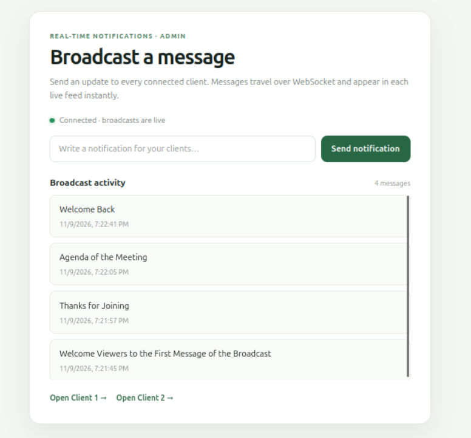
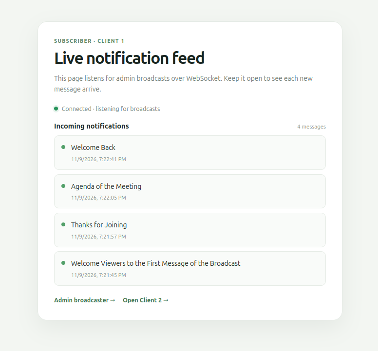
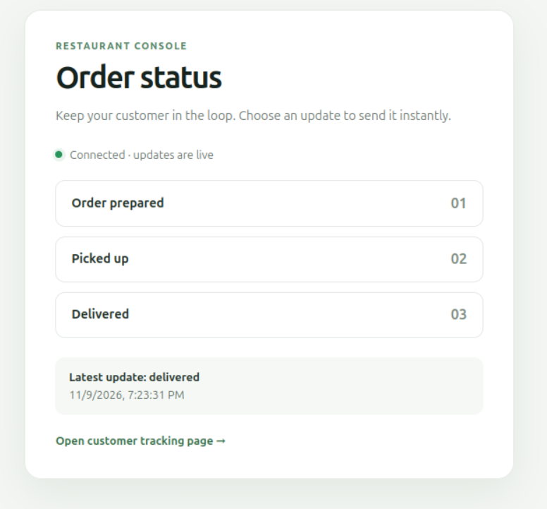
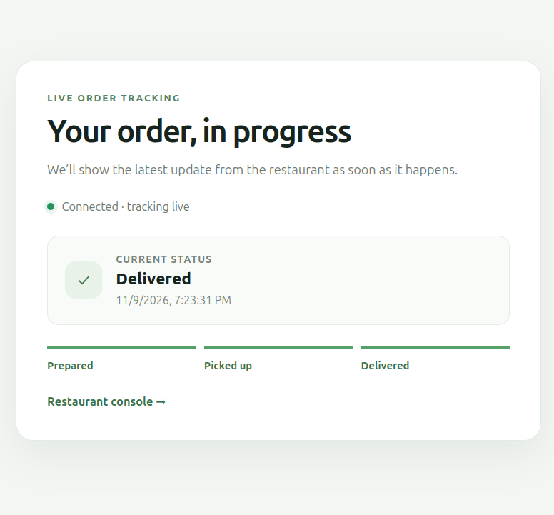

# Real-time notification examples

This Spring Boot project includes two WebSocket demos, served by the same
application and SockJS/STOMP endpoint at `/ws`.

Start the application with `mvn spring-boot:run`, then open the example you
want to try:

## Admin notification broadcast

Open the admin broadcaster and both subscribers in separate tabs:

- Admin broadcaster: `http://localhost:8080/admin`
- Client 1 live feed: `http://localhost:8080/client1`
- Client 2 live feed: `http://localhost:8080/client2`

The admin sends a message to `/app/sendMessage`. Spring broadcasts it with a
server-generated timestamp to `/topic/notifications`, where both clients
receive and display it in real time.

### Screenshots

**Admin broadcaster**

**Client 1 live feed**

## Restaurant order tracking

- Restaurant console: `http://localhost:8080/restaurant`
- Customer tracking: `http://localhost:8080/customer`

The restaurant publishes `prepared`, `pickedup`, or `delivered` to
`/app/order-status`. Spring broadcasts each update with a server-generated
timestamp to `/topic/order-status`. The customer page also receives the latest
status when it connects.

### Screenshots

**Restaurant order controls**

**Customer order tracking**

